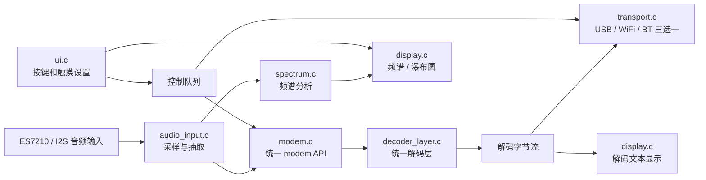
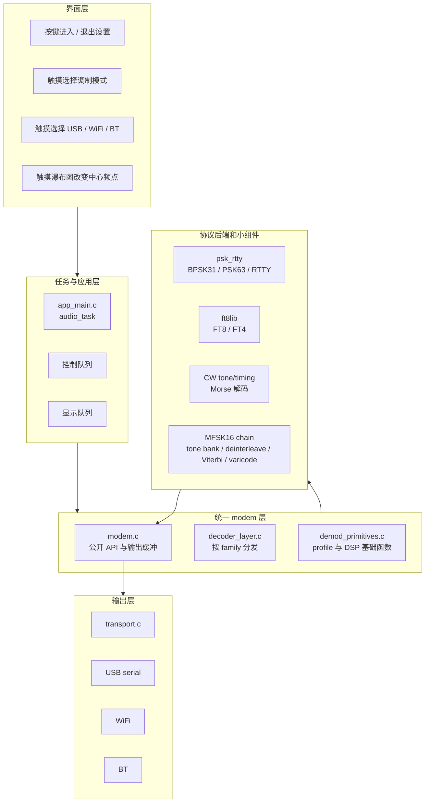
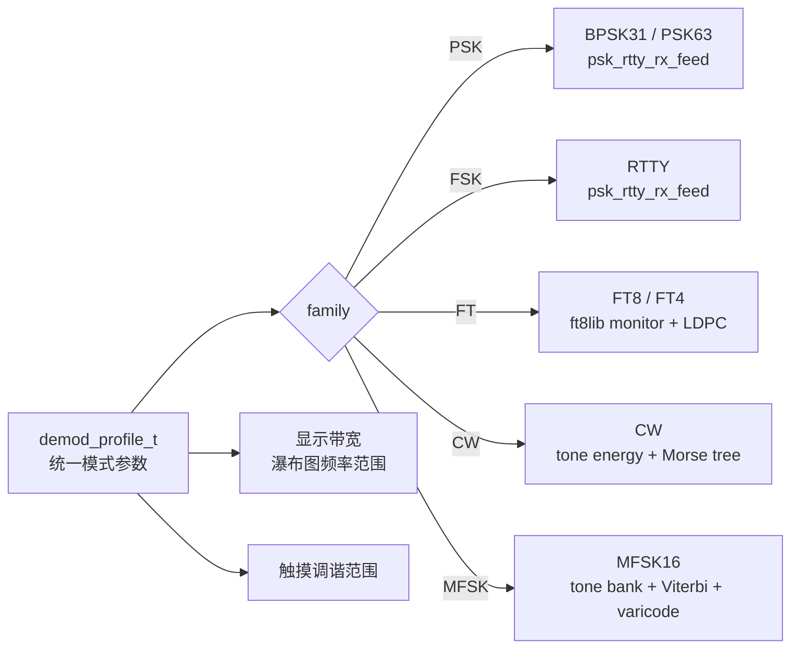
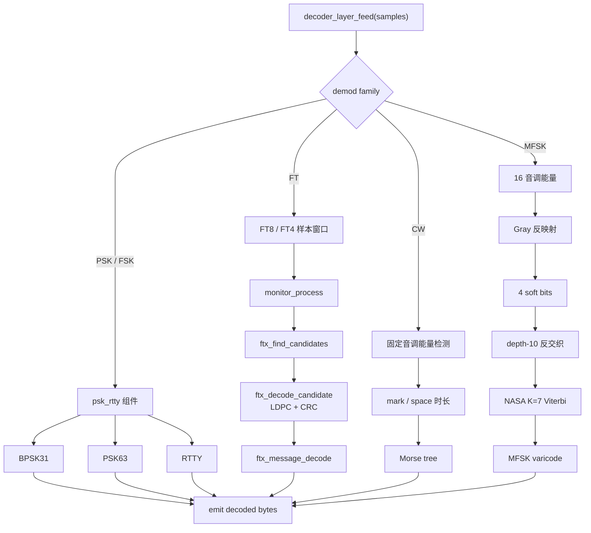
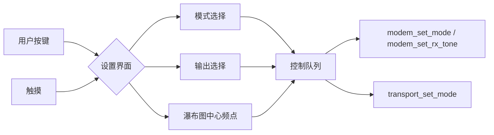
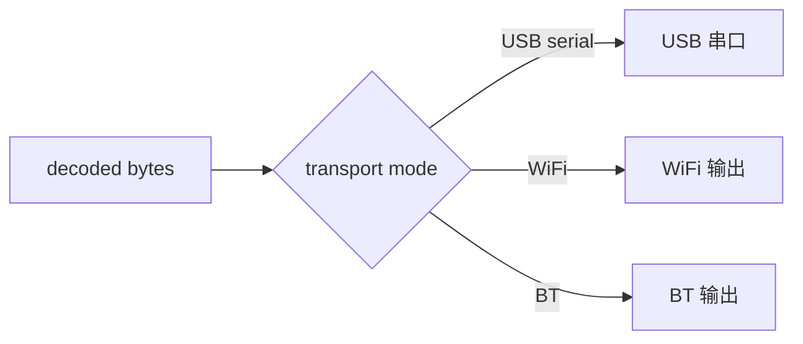
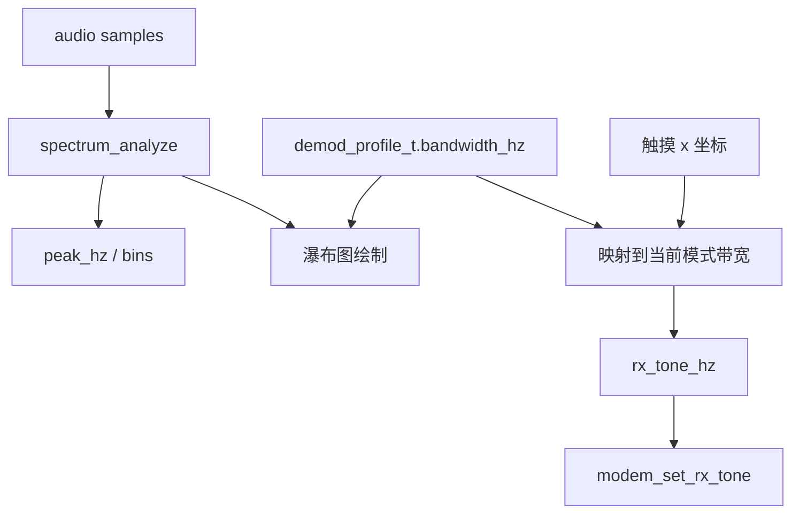

# ESP32-S3 多模式调制解调器架构

## 目标

本项目实现一个基于 ESP32-S3 的触摸控制数字调制解调器，支持 BPSK31、PSK63、FT8、FT4、RTTY、CW 和低速 MFSK16。整体设计的核心是“统一解码层 + 小组件拼接”：所有音频都进入同一个 modem API，再根据模式 profile 选择不同的最小解调组件，而不是为每个调制方式建立一套独立的顶层解码器。

设计规则：

- 所有接收音频都从同一个 modem API 进入。
- 模式差异由 `demod_profile_t` 和小型协议后端选择。
- 移除旧的 `nuepsk` 组件名；PSK 和 RTTY 归入 `psk_rtty`。
- FT8 和 FT4 使用适合 MCU 的轻量 C 后端 `ft8lib`。
- 输出传输方式在 USB 串口、WiFi、BT 中三选一，不能同时启用。
- 屏幕显示根据当前模式 profile 选择瀑布图带宽，并把触摸位置映射为中心频点。

## 总体框架



顶层数据流如下：

```text
ES7210/I2S audio
    -> audio_input decimation to modem sample rate
    -> modem_process()
    -> decoder_layer_feed()
    -> mode family backend
    -> decoded byte stream
    -> selected transport
    -> screen decoded text and waterfall
```

`main/modem.c` 保持很薄。它维护公开 modem 状态和输出缓冲区，然后把所有接收处理交给 `main/decoder_layer.c`。

## 分层职责



各层边界：

- `audio_input.c` 只负责音频采集和抽取。
- `modem.c` 只负责统一 API、模式切换、频点设置和输出缓冲。
- `decoder_layer.c` 负责统一分发和模式后端状态。
- `demod_primitives.c` 负责 profile、tone clamp、tone power 等基础函数。
- `transport.c` 负责二进制字节输出，不能假设输出是 C 字符串。
- `display.c` 和 `ui.c` 只通过事件和 profile 与 modem 交互，不直接操作协议解码器。

## 模式 Profile

模式元数据集中在 `main/demod_primitives.c`。

每个 `demod_profile_t` 描述：

- modem 模式
- 解调家族
- 符号率
- 音调数量
- 音调间隔
- 推荐显示带宽

当前解调家族包括：

- `DEMOD_FAMILY_PSK`：BPSK31 和 PSK63
- `DEMOD_FAMILY_FSK`：RTTY
- `DEMOD_FAMILY_FT`：FT8 和 FT4
- `DEMOD_FAMILY_CW`：CW
- `DEMOD_FAMILY_MFSK`：MFSK16



UI 和瀑布图使用同一张 profile 表，因此新增模式时，解码选择和显示带宽都从同一个数据源变化。

## 统一解码层

`main/decoder_layer.c` 是公共接收分发器。它持有以下共享状态：

- 符号缓冲区
- 当前选择的 demod profile
- PSK/RTTY 后端实例
- FT monitor 实例
- CW 定时状态
- MFSK16 交织器和 Viterbi 状态

主分发逻辑如下：

```c
switch (profile->family) {
case DEMOD_FAMILY_PSK:
case DEMOD_FAMILY_FSK:
    psk_rtty_rx_feed(...);
    break;
case DEMOD_FAMILY_FT:
    feed_ft_symbols(...);
    break;
case DEMOD_FAMILY_CW:
    feed_cw(...);
    break;
case DEMOD_FAMILY_MFSK:
    feed_mfsk16(...);
    break;
}
```

这个结构保持一个公开解码入口，同时允许每个调制家族只组合自己需要的最小组件。

## 解码后端划分



## DSP 基础组件

`main/demod_primitives.c` 提供小型可复用 DSP 辅助函数：

- 模式 profile 查询
- 接收音调范围限制
- 音调功率测量
- Goertzel 风格的音调功率包装函数

更高层的解码器应尽量使用这些函数，避免重复实现频率和音调能量逻辑。

## BPSK31、PSK63 和 RTTY

重命名后的 `components/psk_rtty` 组件负责：

- BPSK31
- PSK63
- RTTY

该组件保留已有的 PSK/RTTY 解调和解码逻辑，但所有外部符号都使用 `psk_rtty` 命名空间。统一解码层把公开的 `modem_mode_t` 映射为 `psk_rtty_mode_t`，并通过回调接收解码字符。

该组件应只关注 PSK 和双音 FSK 模式。共享的模式选择、输出缓冲、显示行为和传输逻辑都放在组件外部。

## FT8 和 FT4

FT8 和 FT4 使用 vendored 的 `components/ft8lib` 后端，该后端基于可移植的 `kgoba/ft8_lib` C 实现。

接收路径如下：

```text
audio samples
    -> monitor_process()
    -> waterfall block accumulation
    -> ftx_find_candidates()
    -> ftx_decode_candidate()
    -> LDPC and CRC validation
    -> ftx_message_decode()
    -> decoded text line
```

当选择 FT8 或 FT4 时，解码层会延迟创建 `monitor_t`。monitor 协议由当前 modem 模式决定：

- `MODEM_MODE_FT8` -> `FTX_PROTOCOL_FT8`
- `MODEM_MODE_FT4` -> `FTX_PROTOCOL_FT4`

呼号 hash 查询和保存由解码层中的小型内存 hash 表提供。

## CW

CW 在统一层中实现为轻量的音调能量和时序解码器。

接收路径如下：

```text
audio samples
    -> tone power at selected CW tone
    -> side-tone/noise comparison
    -> mark/space run lengths
    -> adaptive dit unit estimate
    -> Morse tree table
    -> ASCII characters
```

dit 单元估计从 20 WPM 起步，并在 8 WPM 到 45 WPM 的范围内自适应。这样可以支持手动 CW，同时避免引入大型桌面端状态机。

## MFSK16

MFSK16 在统一层内部实现为组合式协议链。

接收路径如下：

```text
one MFSK symbol of audio
    -> 16 tone energy measurements
    -> Gray reverse mapping
    -> 4 soft bits
    -> depth-10 square deinterleaver
    -> NASA K=7 convolutional Viterbi decoder
    -> MFSK varicode delimiter detection
    -> ASCII characters
```

这替代了早期的原始音调/nibble 输出路径。MFSK16 现在输出解码字符，而不是原始音调索引。

实现有意拆成小块：

- 音调组测量
- soft-bit 生成
- 反交织
- Viterbi traceback
- varicode 解码

这些小块可以独立改进，而不需要改变 modem API。

## UI 和设置

用户按键用于切换设置界面：

- 按一次：进入设置
- 再按一次：退出设置

设置 UI 支持：

- 通过触摸选择调制模式
- 通过触摸选择输出传输方式

同一时间只能启用一种输出传输方式：

- USB 串口
- WiFi
- BT

UI 通过控制队列发送模式、频点和传输方式事件。音频任务接收这些事件，并应用到 modem 和 transport 层。



## 传输

`main/transport.c` 负责 decoded byte delivery。

传输模式是互斥的。切换模式时，旧路径停止使用，后续解码字节只通过新选择的路径发送。



当前传输行为：

- USB 串口把解码后的字节写到 USB serial 输出路径。
- WiFi 通过已配置的 WiFi 路径发送解码字节。
- BT 目前作为可选择模式存在，后续需要按产品要求补齐 BLE/SPP 实现。

transport 接收的是原始二进制字节，不能假设它是 NUL 结尾的 C 字符串。

## 频谱和瀑布图

频谱分析器和显示逻辑与解码器并行运行。显示带宽来自当前激活的 `demod_profile_t`。



触摸交互会把屏幕位置映射为当前模式带宽内的新中心音调，然后通过 `modem_set_rx_tone()` 应用到 modem。

这意味着每个模式都有同一个事实来源来描述：

- 解码参数
- 瀑布图显示宽度
- 有效触摸调谐范围

## 扩展规则

新增或改进模式时：

1. 新增或更新对应的 `demod_profile_t`。
2. 尽量复用已有 DSP 基础组件。
3. 只增加该调制家族真正需要的最小后端状态。
4. 保持公开模式切换在 `modem.c`，统一分发在 `decoder_layer.c`。
5. 通过统一 callback 输出解码字节。
6. 不要为单个模式再新增顶层 decoder API。

新增传输方式时：

1. 放在 `transport_send()` 后面。
2. 保持传输模式互斥。
3. 把输出视为二进制字节，不要当作 C 字符串处理。

## 许可说明

`components/ft8lib` 来自面向 MCU 的 FT8/FT4 C 实现。PSK/RTTY 代码以项目内组件形式保留，并重命名为 `psk_rtty`。

Fldigi 和 uSDX 是有价值的算法参考，但除非整个仓库明确接受兼容的许可证义务，否则应避免批量复制桌面端 GPL 实现文件。
