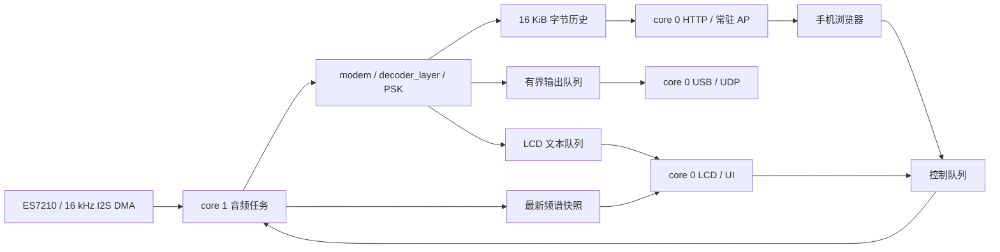

# 接收机架构

- `audio_input.c`：I2S 在 core 1 创建；12×256 帧 DMA，16 kHz 下约 192 ms 缓冲；接收队列溢出计数，保留超时读取中已有的完整采样。
- `app_main.c`：每块最多 256 样本，按 64 样本送入解码器；块尾让出一个 tick。不再通过 RMS 丢弃静音或重置交织器；DMA 丢块时重建当前模式。统计处理预算、峰值耗时、超时块、采样率和输出丢失。
- `components/psk_rtty`：参考 HPM 的滤波、同步、AFC、varicode、FEC；模式目录和映射也归此组件。全局 FEC 工作区仅供一个解码实例使用。
- `PSK_RTTY_MAX_FEC_K=7`：在线构建为 64 状态、8 字节/路径行；高 K 模式在网页、按键、串口、modem API 和底层 feed 均有约束。
- `decoder_layer.c`：统一模式入口。48 KiB MFSK 工作区放在 PSRAM，PSK 热状态留在片内；框架使用一个解码实例，不能并发运行多个实例共享 FEC/MFSK 全局工作区。
- `web_rx.c` / `rx_history.c`：短临界区复制历史或状态，JSON 格式化和 socket 发送在锁外。手机用 64 位游标独立读取最多 512 字节；会话号识别重启。历史覆盖与接收丢样分别报告。
- `main/web/index.html`：随固件嵌入，无 CDN。250 ms 轮询，积压时加速。UTF-8 文本/HEX/原始数据保存，不解释接收内容中的 HTML。
- `transport.c`：AP 开机常驻，USB/UDP 为旁路；音频任务只做非阻塞队列入队。
- `display.c`：76800 字节瀑布图画布在 PSRAM，SPI DMA 刷新缓冲仍在内部 DMA 内存。

AP 不提供互联网转发或强制门户。读取接口：`/api/status`、`/api/modes`、`/api/rx?since=...&session=...`。`POST /api/control` 接受 `mode=8PSK1200F` 或 `tone=1500`，要求 `X-Modem-Control: 1` 头，返回 `202` 表示已排队，状态随后反映应用结果。

普通 PSK 文本没有端到端 CRC 和重传。锁定、处理余量及收到字节均不代表零误码；端到端准确性需与已知正文或带 CRC/序号的帧比较。
